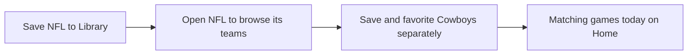
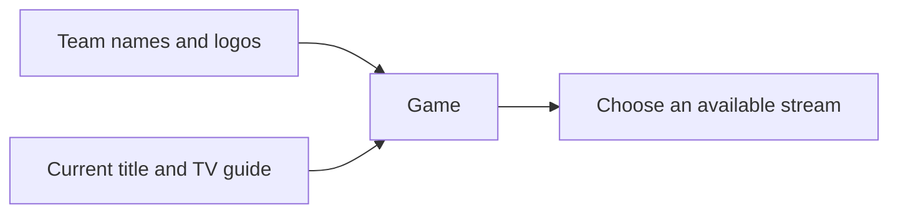
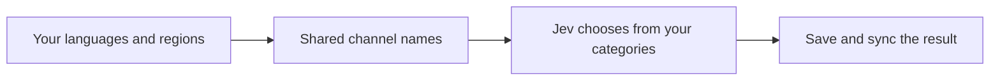
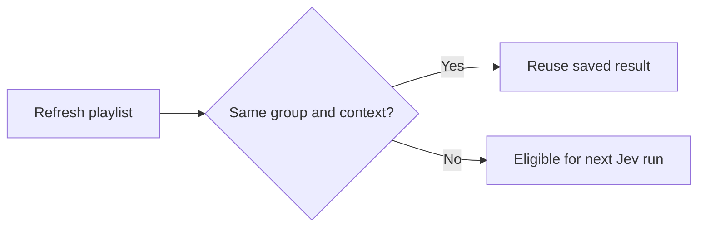

# Group organization and app terms

This supersedes the previous per-channel AI organizer proposal. The screens continue to use native SwiftUI lists, navigation, sheets, search, and controls.

## Content names

| Term | Meaning | Example |
| --- | --- | --- |
| Source | A provider account or playlist | Your Xtream source |
| Channel / stream | A retained playable provider entry; a game can have several | A 1080p feed and a 4K feed |
| Channel group | Shared names with a stable identity, without merging playback | Golf 01, Golf 02, Golf 03 |
| Category | A broad content subject | Sports, News, Learning |
| Subcategory | A narrower level, including a sport or a topic | American Football, Local, Astronomy |
| League | A sports competition; can also be a category-path level | NFL |
| Team | An identified participant in a league | Dallas Cowboys |
| Game | Two identified opponents at a guide-supported time | Cowboys vs Packers tonight |
| Library | Everything you explicitly saved: channels, categories, teams, leagues and collections | NFL in your Library |
| Favorite | An independent priority within saved items | Cowboys saved and starred |
| Interests | Categories expanded first on Live | Sports and News |
| My Lineup | Region/language filtering, selectable in the filter menu | US / English |
| Favorites Today | Matched playable listings on now or later today | Hidden entirely when empty |

Live is the main browsing screen; Guide shows schedules; Sports shows games and sport categories; Library contains saved items; Search uses the native header search field. Sports is both a screen name and a content-category name. The Sports tab is a shortcut to sports broadcasts. A Sports category is the label used to organize channels. Neither creates a second Library. Saving NFL saves one NFL item; open it to browse teams, then save a team separately if wanted.

## Small content maps

Categories organize the channels. Each level narrows the subject.

Library saves what you follow. Favorites independently choose what gets priority.

Game matching stays separate from channel categories.

## Decision flow

Clear decisions are applied. Uncertain ones wait for review. None means a suitable label is missing; manual naming works now, while Apple PCC naming is still disabled.

## Saving and refreshing

Every stage has an explicit None option. Narrower stages also have a Here option so a general sports channel is not forced into one sport or league. Settings → AI → Your Categories lets the person create, rename, or remove the choices. New profiles must choose before their first Jev run; optional starters have no preselected choices. Existing profiles retain their established choices for compatibility. Deterministic metadata hints remain for immediate offline browsing. New accepted paths appear in the browser, Interests, and later model choices. Editing choices does not erase previous results.

The preferred region/language audience is independent of the browser filter. Viewing All Channels never sends other regions to Jev. The separate Unknown Languages setting can include provider entries without language metadata when their region matches.

## Reload behavior

Group identity uses normalized names and explicit language/region editions. It omits provider stream IDs, quality labels, numbered slot suffixes where a repeating family was detected, and playback URLs. Once a family has a saved decision, it stays recognized even if fewer numbered members remain after refresh. All original entries remain playable separately. Ordinary first words do not combine unrelated channels. A changed provider context invalidates an automatic decision; manual corrections remain protected.

Game information is deliberately shorter-lived. Existing opponent parsing uses the current title and the local sports directory. The current guide supplies times. Both opponents, a compatible league, and timing evidence are required by the existing matching flow; a category decision never proves a game is live, never invents an opponent, and never inherits last week's game from a reused slot. Unknown/replay/ambiguous cases stay unconfirmed.

## Performance and controls

Sports owns two reusable prepared results (All Sports and My Sports) for the app lifetime. Re-entering a tab reuses a result. Catalog changes, game-link changes, following changes, region/language changes, or the next minute invalidate it. A minute update retains existing visible content. The full scan for unscheduled matching channels runs only when its disclosure is opened.

Favorites Today loads from a task on the always-present Live screen; an empty section has no header, placeholder, or spinner. Refreshes show import progress without a Cancel Import action; new-source imports retain cancellation.

Live shows one native spinner where its navigation title would be, within the existing soft scroll edge. Opening the saved catalog, actual iCloud activity, playlist import/refresh, Jev, and feed preparation can all activate it. It disappears when no work remains; there is no extra progress panel. Favorites Today stays hidden while preparing or when empty. The AI page keeps the detailed progress bar, count, and Pause/Resume.

Each organization batch is saved before its queue checkpoint advances. Apple's system Live Activity allows a user-started run to continue after leaving the app when continued processing is granted. If iOS stops work, or after reopening an interrupted app, Resume picks up unfinished groups and skips decisions already received from iCloud. Completed decisions sync; the active work queue stays on the device where the run started.

## Capability status

The personal Jev key is provisioned outside source control and stored separately on each device in Keychain. The optional cloud-processing toggle controls outgoing group metadata. The old model picker and per-channel model/gateway are removed; local natural-language Search still uses Apple Intelligence when available.

PCC naming is implemented behind the existing disabled entitlement flag. Apple requires eligible account enrollment and its entitlement; this development build does not claim cloud naming is active. None therefore remains reviewable and manually editable. Downloadable decision models are a future adapter, not a current download.

## Validation

Evidence and measured physical-device results are recorded in build-progress.md after testing. Core regressions cover stable identities through reloads, fewer slots, changed context, edition separation, dynamic paths, manual overrides, bounded metadata-only requests, hierarchical/None routing, uncertainty, and invalid responses.

## Automatic refresh and Siri

Automatic Refresh has separate playlist and guide frequencies (daily and six hours by default). Each device uses its own successful-refresh dates. Full refresh includes the guide; guide-only updates retain the channel catalog and do not advance playlist freshness. Failed attempts wait an hour before another automatic attempt. iOS chooses background execution time; foreground activation catches up overdue sources. Pull-to-refresh covers every configured source, sequentially. No refresh calls Jev or removes personal decisions.

Siri/App Shortcuts: play a channel, search actual channels/programs, open a saved Library item, save a channel, open the guide, and refresh sources. Search and saved-item opening adopt the iOS 27 system schemas. On-screen channels expose entity identifiers. The system catalog omits credentials/stream URLs and honors preferred regions/languages plus explicitly saved channels. Only saved items are indexed for Spotlight. Recognizing a spoken Siri request is a separate device acceptance gate from successful App Intent routing.

## Data provenance

Original channel names/groups, streams and guide listings come from the provider. Names/logos from API-SPORTS are a bundled downloaded reference snapshot, supplemented by built-in offline team/league aliases; the app does not fetch current API fixtures. Local sport/country/language recognition and optional starting choices remain code/data in the app. Jev placements and personal corrections are separate saved records. Settings and each channel's details expose these origins. No additional AI naming service is enabled by this change.
